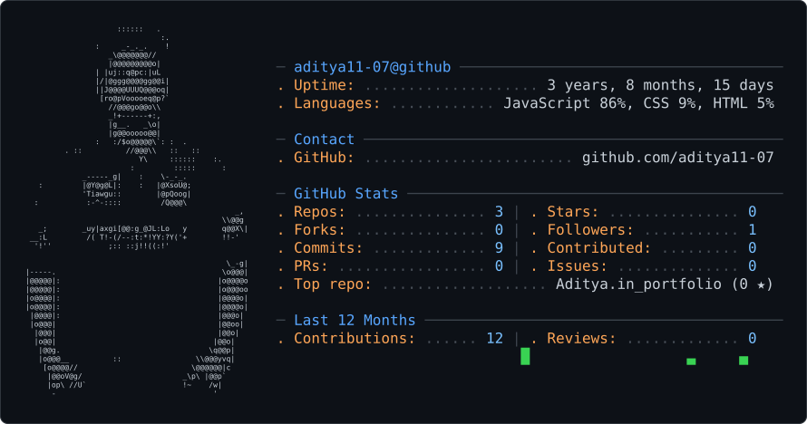

# Hey, I'm Aditya Pandey 👋

### 💻 Frontend Developer | 🚀 Rocket Avionics | ⚡ Embedded Systems

I'm a Computer Science & Engineering student at **PSIT, Kanpur**, passionate about building technology that connects software with the real world. From developing web experiences to working on rocket avionics and embedded systems, I enjoy learning by building, experimenting, and solving practical problems.

---

### 🚀 What I'm Working On

- 🚀 Developing avionics and telemetry systems with **Team Vyomnauts**.
- ⚡ Building embedded projects using **ESP32, Arduino, and sensors**.
- 💻 Improving my frontend development skills and creating interactive web applications.
- 🛰️ Exploring aerospace technology, electronics, and real-world engineering challenges.

### 🛠️ Tech Stack

- **Languages:** C, C++, JavaScript
- **Frontend:** HTML, CSS, JavaScript
- **Embedded Systems:** ESP32, Arduino, sensor integration
- **Tools:** Git, GitHub, EasyEDA, PCB Design

### 🎯 Currently Learning

- Modern frontend development
- Data Structures and Algorithms
- Embedded systems and avionics
- Hardware–software integration

### 🤝 Let's Collaborate

I'm open to collaborating on innovative projects, exploring new technologies, and connecting with developers and engineers who love building things.

### 📫 Find Me Online

- **GitHub:** [@aditya11-07](https://github.com/aditya11-07)

---

*Build. Learn. Experiment. Repeat. 🚀*

<picture>
  <source media="(prefers-color-scheme: dark)" srcset="dark_mode.svg" />
  <source media="(prefers-color-scheme: light)" srcset="light_mode.svg" />
  
</picture>
